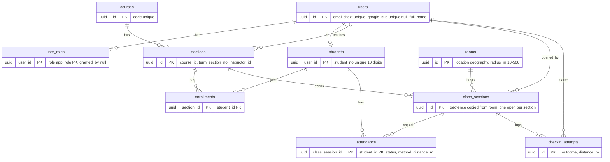

# Entity-relationship diagram

Tables from `db/migrations/20261012090000_tables.sql`. Attendance "absent" is not a row: it is an enrolled student with no `attendance` row (a view, task P4).

`audit.events` is separate: it is filled by triggers (task P5) and has no foreign keys.
